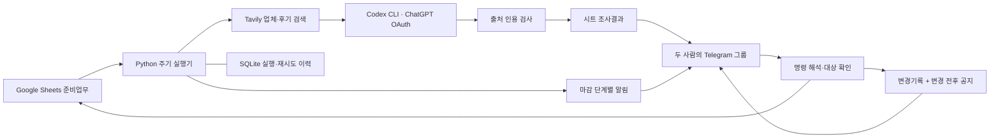

# Oh My Wedding

두 사람이 Google Sheets에 정한 **조사 대상·상태·마감**을 읽고, 업체 조사와 일정 알림을 Telegram 그룹에 전달하는 작은 Python 서비스입니다. 그룹 명령으로 시트를 수정하고 변경 내역도 공유합니다. **ChatGPT AI는 Codex CLI의 OAuth 로그인으로 실행하며 OpenAI API 키로 전환하지 않습니다.**

현재는 실행 가능한 초기 구현입니다. 로컬 예제와 모의 API의 **83개 테스트가 통과했고 실제 ChatGPT OAuth 추론도 확인했습니다.** 실제 Google Sheets 쓰기·Telegram 발송·검색 API 연결은 아직 설정하지 않았습니다. 기존 결혼 준비 시트는 수정하지 않았고 상시 프로세스도 시작하지 않았습니다. [검증 범위](docs/verification.md)

## 흐름



## 구현된 동작

| 요구 | 동작 |
| --- | --- |
| 미정 영역 주기 조사 | `조사여부=TRUE`, 상태 `미정/조사중/상담중`인 행을 기본 7일 간격으로 조사합니다. 지역이 비어 있으면 입력을 요청합니다. |
| 업체 정보 정리 | 영역·지역을 기준으로 공식 가격과 후기 관련 검색을 2회 실행합니다. 업체별 지역·가격·장단점은 실제 검색 발췌에 존재하는 인용만 정리합니다. 검색 관련도를 평점으로 바꾸지 않습니다. |
| 정보 갱신 | 조회일·게시일·출처 URL을 저장합니다. 출처 내용이 바뀐 경우에만 새 결과를 기록하고 공지합니다. 예산은 비교 조건으로 전달하지만 자동 가격 필터의 정확성을 보장하지 않습니다. |
| 일정 알림 | 30·14·7·3·1일 전과 당일에 단계별 한 번, 지연된 업무는 7일 구간마다 한 번 알립니다. 재시작하면 지난 모든 알림 대신 현재 해당하는 단계만 보냅니다. |
| 시간 | 기본 Asia/Seoul 20:00~21:00에 자동 조사·알림을 실행합니다. 그룹 명령 응답은 시간 제한이 없습니다. |
| 완료 처리 | 예약완료·계약완료·완료·취소·보류인 해당 업무의 조사와 마감 알림을 중단합니다. 계약과 실제 촬영은 서로 다른 업무로 등록합니다. |
| 시트 수정 | `/edit 업무ID 열=값`으로 변경 셀만 수정하고 다시 읽어 확인합니다. 요청자·변경 전후 값은 기록 탭과 그룹에 공유합니다. |
| 실패 복구 | 먼저 결과/변경기록을 시트에 저장한 뒤 공지합니다. 실패한 메시지는 재시도하며 같은 수정 요청을 반복 적용하지 않습니다. 완료된 업무의 오래된 대기 알림은 버립니다. |
| 원본 보호 | 기존 자유 형식 17개 탭은 자동 해석하거나 변경하지 않습니다. 자동화 전용 3개 탭을 제안하며 현재는 로컬 예제로 실행합니다. |

동일한 HTTP 요청이 서버에서 성공한 직후 연결이 끊기면 Telegram API에는 클라이언트의 중복 제거 키가 없어 메시지가 한 번 더 전달될 가능성은 남습니다. 상태 DB와 시트 기록ID로 일반적인 재시도 중복은 줄였으며 완전한 exactly-once 전송을 주장하지 않습니다. Sheets의 동시 UI 편집 역시 원자적으로 잠그지 못하므로 최신 값 비교·재조회로 충돌을 감지합니다. 한 봇 프로세스로 운영합니다.

## 지금 실행해 보기

Python 3.11 이상이 필요합니다. PowerShell에서 프로젝트 폴더를 열고 실행합니다.

```powershell
python -m venv .venv
.\.venv\Scripts\python.exe -m pip install -e .
.\.venv\Scripts\python.exe -m wedding_assistant demo
.\.venv\Scripts\python.exe -m unittest discover -s tests -v
```

`demo`는 외부 키 없이 가상 업체·가상 일정만 사용합니다. 생성된 `artifacts/demo-*/transcript.md`에서 알림, 중복 억제, 계약완료 수정 공지를 볼 수 있습니다. 실제 공지와 시트 쓰기는 발생하지 않습니다.

로컬 자료를 직접 바꿔보려면 다음 명령을 사용합니다.

```powershell
.\.venv\Scripts\python.exe -m wedding_assistant init-local
.\.venv\Scripts\python.exe -m wedding_assistant chat '/status'
.\.venv\Scripts\python.exe -m wedding_assistant chat '/edit W001 상태=계약완료 업체="가상 스튜디오 A"'
.\.venv\Scripts\python.exe -m wedding_assistant tick --at '2026-11-01T20:00:00+09:00'
```

`chat`·`tick`은 `.env`의 모드를 따릅니다. 기본 `demo`에서는 로컬 파일만 바꿉니다. `live`로 전환하면 실제 연결에 적용되므로 전환 과정은 [운영 안내](docs/operations.md)를 따르세요.

## 실제 연결에 필요한 것

1. 두 사람과 봇이 들어갈 **Telegram 그룹** 및 BotFather 봇 토큰.
2. 실행 장치에 설치된 **Codex CLI와 ChatGPT OAuth 로그인**. `codex login`으로 로그인합니다. 토큰을 복사하거나 앱의 `.env`에 넣지 않습니다.
3. 검색 데이터를 가져올 **Tavily 키**. 이는 ChatGPT 모델 인증과 별개입니다.
4. Google Sheets API가 활성화된 **Google 서비스 계정**과 사용자가 준비한 자동화용 3개 탭. 현재 앱의 Google 연결 자격증명을 백그라운드 Python으로 복사하는 방식이 아닙니다.
5. 켜져 있는 PC·NAS·서버. 잠자기/종료 중에는 메시지 수신과 정기 실행이 멈춥니다.

시트에 필요한 변경은 [준비업무·조사결과·변경기록 설계](docs/sheet-plan.md)에 열 이름과 빈 헤더 템플릿으로 정리했습니다. 지금 당장 적용할 필요는 없고, 실제 연결 시 기존 탭 옆에 추가하는 방식입니다.

```powershell
codex login status
.\.venv\Scripts\python.exe -m wedding_assistant oauth-check
# 실제 OAuth 추론 한 번 확인. 소량의 ChatGPT 사용량 발생, 시트/메신저 호출 없음.
.\.venv\Scripts\python.exe -m wedding_assistant oauth-check --infer
```

OAuth 실행에서는 API 키로 자동 대체하지 않습니다. 로그인 만료·권한·사용량 문제는 연결 오류로 처리합니다. `AI_BACKEND=none`을 직접 지정하면 AI를 쓰지 않는 검색 발췌 모드가 됩니다. [OAuth 인증의 범위](docs/oauth.md)

## Telegram에서 쓰는 명령

```text
/help
/status
/schedule
/research W001
/edit W001 상태=계약완료 업체="선택한 업체명"
/edit W002 마감일=2027-04 담당=공동
/edit W002 예약일시=2027-04-10T14:00+09:00
/edit W001 조사여부=아니오
```

그룹의 봇 privacy mode를 유지해도 받을 수 있도록 ASCII 명령을 사용합니다. 필요하면 `/edit@봇아이디`처럼 지정합니다. 현재는 **명시적인 명령으로 수정하는 버전**이며 “지난번 업체로 바꿔줘” 같은 자유 대화의 모호한 지시를 임의 실행하지 않습니다. 전체 채팅방 수다를 모델에 보내는 구조도 아닙니다.

## 설계·조사 자료

- [메신저 비교](docs/messengers.md): 카카오 일반 단톡방의 공식 연동 제약, Telegram 권장 이유, Discord 대안.
- [오픈소스 조사](docs/open-source.md): n8n·Activepieces·APScheduler·봇 라이브러리·Google 클라이언트·크롤러 비교와 출처.
- [운영 안내](docs/operations.md): 인증, 설정, 실제 실행, 상시 가동, 문제 확인.
- [시트 변경안](docs/sheet-plan.md): 14개 준비업무 열과 7개 조사결과 열, 5개 변경기록 열.
- [작업 지침](AGENTS.md): 불필요한 보안 기능 금지, 원본 수정 금지, OAuth 원칙.
- [검증 기록](docs/verification.md): 자동 테스트, 실제 OAuth 확인, 아직 연결하지 않은 외부 기능의 구분.

현재 의존성은 작은 HTTP 클라이언트와 Google 공식 클라이언트 중심입니다. 별도 워크플로 서버, 큐 서버, 대형 크롤러는 도입하지 않았습니다. 시각적인 자동화 편집이 필요해질 때 Activepieces, 동적 페이지 수집이 실제로 필요할 때 Playwright를 검토하면 됩니다.

추가로 활용하기 좋은 것은 **잔금 납부·후기 포인트 신청 마감**을 업무 행으로 등록하는 것입니다. 이미 구현된 일정 알림을 그대로 쓸 수 있습니다. 계약금/잔금 자동 결제, 포인트 자동 신청, 업체에 예약 메시지 발송은 현재 구현 범위에 포함하지 않습니다.
